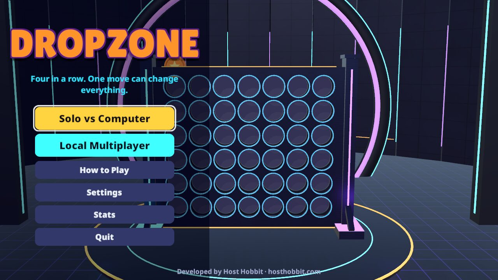
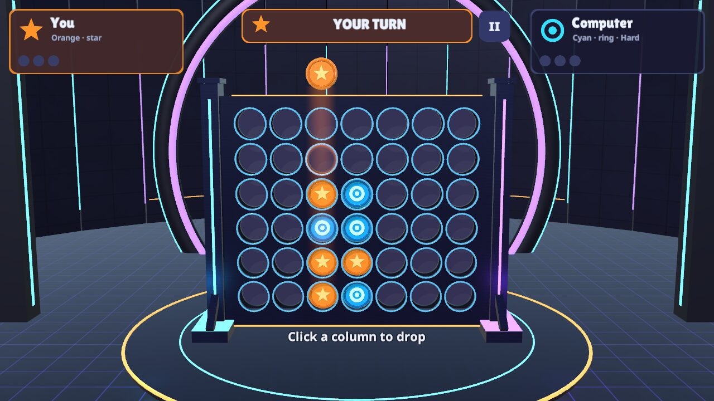
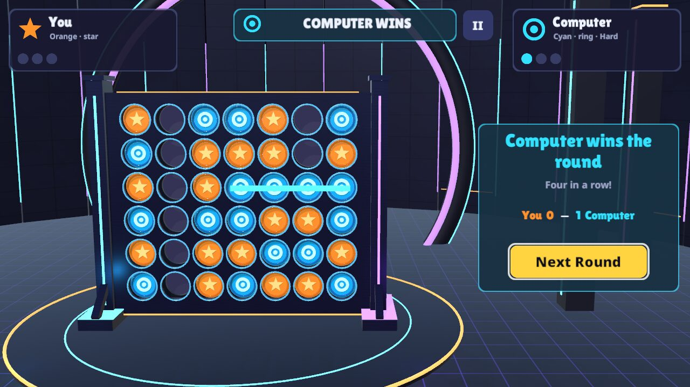
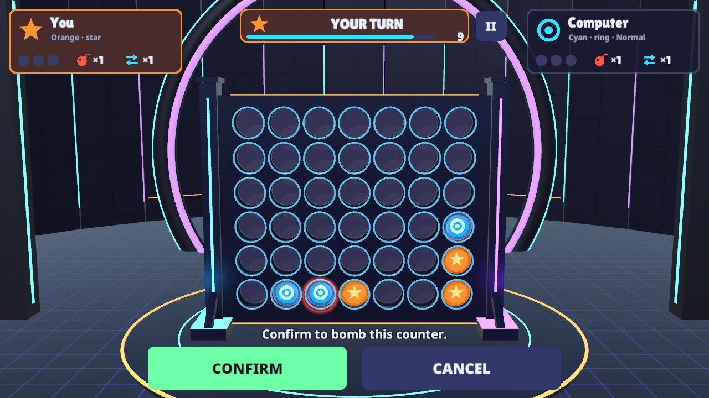
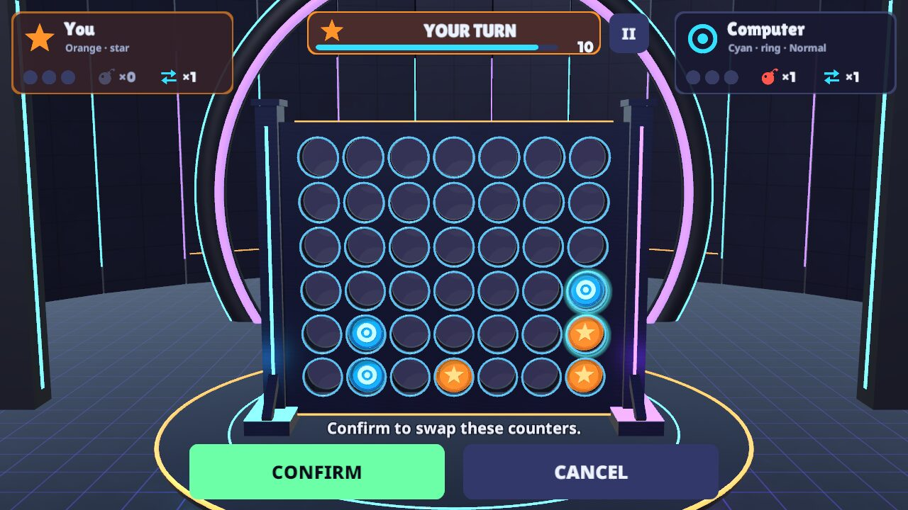
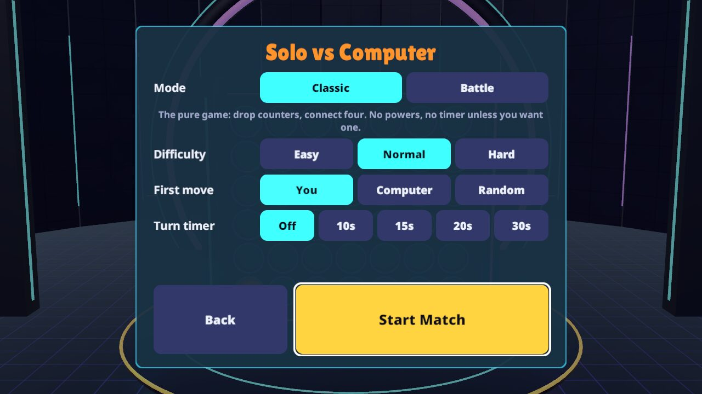
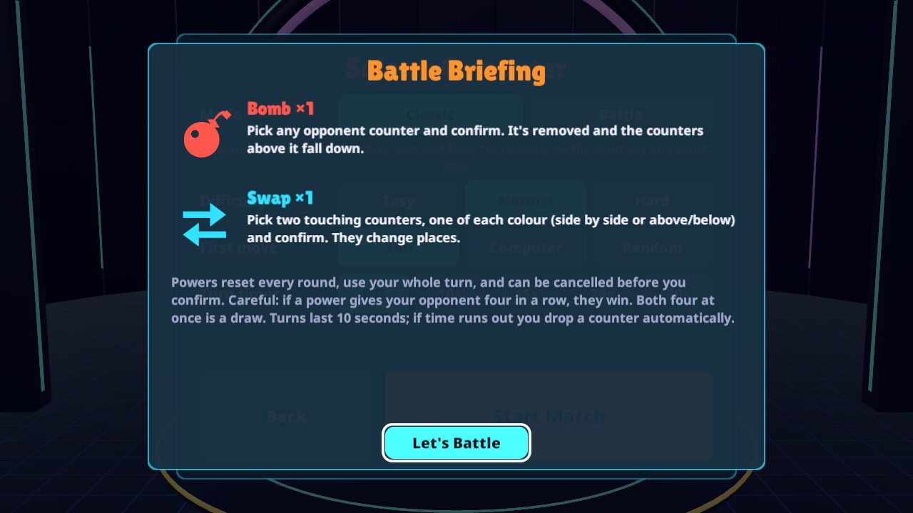
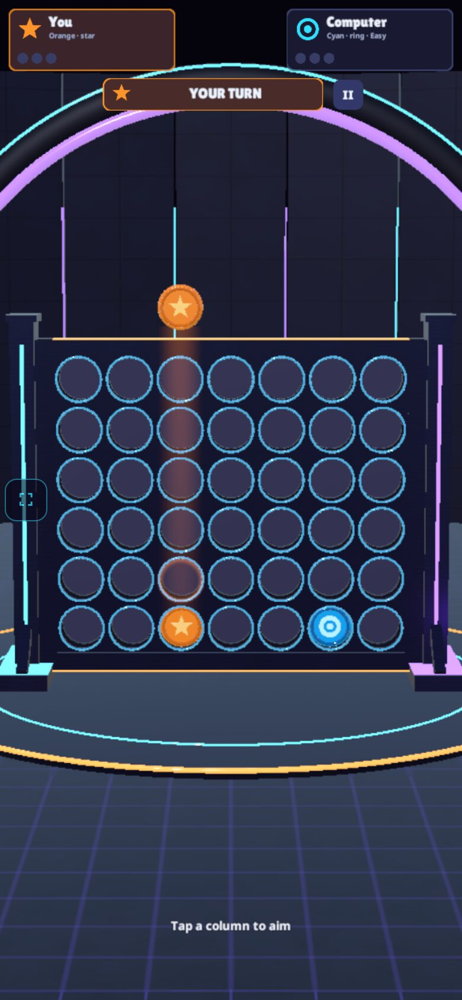
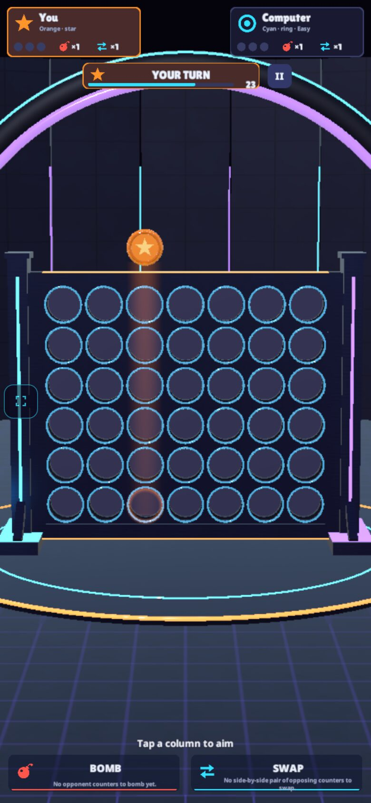

# DropZone

**Four in a row. One move can change everything.**

A polished 3D four-in-a-row game made in Unity. It has a tactical **Battle** mode: ten-second turns, and one Bomb and one Swap per round. Play the computer on Easy, Normal or Hard, or a friend on the same computer, phone or tablet.

### ▶ [Play it in your browser](https://hosthobbit.github.io/dropzone/)

It works with mouse, keyboard, touch and gamepad. Developed by [Host Hobbit](https://hosthobbit.com).



| | |
|---|---|
|  |  |
|  |  |
|  |  |

<p align="center"> &nbsp; </p>

All screenshots come from the automated test runs of the real game: the Linux desktop build and the browser build in headless Chromium. Both use software rendering, so they show exactly what the game draws, but not how smoothly it runs on a graphics card.

## Game modes

| Mode | What it is |
|---|---|
| **Classic** | 7 columns × 6 rows. Take turns dropping counters; four or more in a row (across, up or diagonal) wins the round. A full board with no line is a draw. There are no powers. An optional turn timer is off by default. |
| **Battle** | The same board and goal, with 10-second turns (Off/10/15/20/30 s can be chosen). Each player gets one **Bomb** and one **Swap** per round. |
| **Solo** | Classic or Battle against the computer on **Easy**, **Normal** or **Hard**. You choose who goes first: you, the computer or random. |
| **Local multiplayer** | Two players on one device. The current player is shown on the turn banner and highlighted on their card. Pass the device between turns. |

A match is **first to three round wins**. A drawn round gives nobody a win, and the first move switches every round. Solo results are saved as stats on the device.

### Battle rules

- **Bomb.** Pick one opponent counter anywhere on the board. A red ring shows which counter will go, and you must confirm. That counter is removed and everything above it falls one row. You can't bomb an empty space or your own counter.
- **Swap.** Pick two counters, one of each colour, that touch side by side or above and below (not diagonally). Both are highlighted and you must confirm. They exchange places.
- A power **uses your whole turn**, can only be used once per round, and resets at the start of each round. Both players' remaining powers are always shown on the player cards.
- **Cancelling costs nothing.** Backing out of a Bomb or Swap selection keeps both the power and your turn.
- If a power has no legal target, its button is disabled and the reason is shown underneath (for example, "No opponent counters to bomb yet").
- **Resolving a move:** input is locked while it plays out. The logical board is updated first, then animated, and then **both** players are checked on the settled board:
  - only one player has four in a row: that player wins, even if the other player's move created the line;
  - both players have four at once: the round is a draw;
  - the board is full with no line: the round is a draw.
- **Running out of time:** a normal counter is dropped automatically and "Time up — automatic drop" is shown. Columns are tried centre first (3, 2, 4, 1, 5, 0, 6). A power is never used for you. The timer freezes while moves animate and while the game is paused.

## Controls

| | Mouse | Touch | Keyboard | Gamepad |
|---|---|---|---|---|
| Choose a column | point at it | tap it | ← → or A D | d-pad / left stick |
| Drop | click | tap the same column again | Enter or Space | A |
| Bomb / Swap | on-screen buttons | on-screen buttons | B or 1 / X or 2 | X / Y |
| Pick a target | click a counter | tap a counter | arrows, then Enter | d-pad, then A |
| Confirm a power | Confirm button, or click the target again | Confirm button, or tap the target again | Enter | A |
| Step back / cancel | right-click or the Cancel button | Cancel button | Backspace (one step), Esc (cancel) | B |
| Pause | pause button | pause button | Esc or P | Start |

- Menus work fully with keyboard and gamepad, and focus is always outlined.
- Clicks on buttons never pass through to the board.
- Each player has a different colour and an embossed symbol (**orange star** and **cyan ring**), so colour is never the only clue.
- If the browser loses focus (switching tabs or apps), a solo or local game pauses itself.

## Settings

The settings are music volume, sound volume, graphics quality (Low/Medium/High), **reduced motion**, and **camera shake** on or off. Reduced motion shortens animations and turns off bouncing, camera movement and most particles. Settings and stats are saved on the device (PlayerPrefs; in the browser that's the site's local storage).

## Project facts

- **Unity version:** Unity **6000.6.3f1** (Unity 6.6) with the **Universal Render Pipeline**.
  - The brief asked for an LTS release, but **no LTS editor is installed** on the build machine, so the game is built with this one.
  - Nothing in it depends on 6.6-only features. It uses URP, the Input System and uGUI only.
- **Packages:**
  - `com.unity.render-pipelines.universal` 17.6.0
  - `com.unity.inputsystem` 1.20.1 (the new Input System only)
  - `com.unity.ugui` 2.6.0
  - `com.unity.test-framework` 1.8.0
- **Everything is generated from code.** The Editor tool `DropZone → Build Everything (assets + scene)` creates every texture, material, mesh, prefab, quality preset and the scene. The generated assets are committed, so the project opens ready to play.
- **No external server.** All gameplay, the AI and the stats run locally.

### How the code is organised

```
Assets/DropZone/
  Scripts/Core      pure C# rules (no Unity dependencies): Board, RoundState, GameAction, Match, TurnClock,
                    TurnInput (selection/confirm/cancel), AiPlayer (search)
  Scripts/Game      GameController (explicit phases, the single authoritative match state), Settings, QaDriver
  Scripts/Board     BoardView (draws and animates the logical board), CounterView, CameraRig, Fx
  Scripts/Input     GameInput (Input System actions for keyboard, mouse, touch, gamepad)
  Scripts/UI        UIManager (all screens, built in code), UiKit, FocusRing
  Scripts/Audio     Sfx (synthesised sound effects and music)
  Editor/           DropZoneBuilder, SceneBuilder, MeshKit, TextureKit
  Tests/EditMode    RulesTests, AiTests
Assets/WebGLTemplates/DropZone   browser loading page
```

- **Rules.** Every move is a `GameAction` (Drop, Bomb or Swap). `RoundState.IsLegal` validates it and `RoundState.Apply` resolves it. The view only animates the result and then re-syncs from the logical board. No physics ever decides where a counter goes.
- **AI.** `AiPlayer` is iterative-deepening alpha-beta search on bitboards, with centre-first move ordering and an evaluation of open lines, playable threats, centre control and powers in hand.
  - It includes Bomb and Swap in the search and handles simultaneous lines.
  - It runs under a time and node budget and **yields between root moves**, so it spreads over frames without threads (needed for WebGL). Restarting cancels it.
  - Easy searches 2 moves ahead and sometimes makes a careless move. Normal searches 3–4 moves ahead. Hard deepens until about 0.9–1.1 s of search time.
  - On the build PC, natively, Hard reaches 9–11 moves ahead in Classic in under 0.4 s.
  - It follows the same rules, timers and power limits as a human and never sees anything a player couldn't.

## Open, play and build

1. Install Unity **6000.6.3f1** with **Linux Build Support** and/or **Web Build Support** (plus Windows or Mac support if you want those).
2. Open the folder in Unity Hub, open `Assets/DropZone/Scenes/DropZone.unity`, and press Play.
3. After changing anything in `Assets/DropZone/Editor/`, regenerate with **DropZone → Build Everything (assets + scene)**.

From the command line (the scripts regenerate everything first):

```bash
./build.sh        # Linux desktop build  -> Build/Linux/DropZone.x86_64
./play.sh         # run it
./build-web.sh    # browser build        -> Build/WebGL/
cd Build/WebGL && python3 -m http.server 8000    # then open http://localhost:8000
```

The scripts expect the editor at `~/Unity/Hub/Editor/6000.6.3f1/Editor/Unity`; set `UNITY=/path/to/Unity` to use another location. Windows and Mac builds can be made from **File → Build Profiles** after generating, but only the Linux and WebGL builds have been made and tested.

### GitHub Pages

The browser build is plain static files. It uses gzip with Unity's decompression fallback, so it needs no special server headers.

1. Run `./build-web.sh`.
2. Publish the contents of `Build/WebGL/` plus an empty `.nojekyll` file to a `gh-pages` branch:
   ```bash
   cp -r Build/WebGL /tmp/dz-pages && touch /tmp/dz-pages/.nojekyll
   cd /tmp/dz-pages && git init -b gh-pages && git add -A && git commit -m "Browser build"
   git push -f https://github.com/<you>/dropzone.git gh-pages
   ```
3. In the repository settings, set **Pages → Source** to the `gh-pages` branch, root folder.

Everything is loaded with relative paths, so it works from a subdirectory such as `/dropzone/`.

## Testing: what was actually checked

There are three kinds of check: automated tests of the rules, scripted play of the real built game, and simulated input devices. **No real gamepad, touchscreen or graphics card was used in testing.** The automated runs are kept off this machine's GPU on purpose, and audio is muted.

**1. Unit tests (EditMode, 42 tests, all passing)**

```bash
Unity -batchmode -nographics -projectPath . -runTests -testPlatform EditMode -testResults Logs/tests.xml
```

They cover:

- horizontal, vertical and both diagonal wins, and lines longer than four;
- full columns and invalid drops;
- full-board draws;
- Bomb targeting (no empty or own counters) and gravity after a Bomb;
- Swap adjacency and target rules (diagonal, empty, same owner and distant all refused);
- powers used only once, using the whole turn and resetting each round;
- cancelling a selection keeps the turn and the power;
- a move that creates only the opponent's line gives them the win;
- simultaneous lines are a draw;
- timeout drops (centre first, never a power, a draw on the last space);
- the turn clock freezing;
- match scoring (first to three, draws score nothing) and alternating starters;
- every difficulty making only legal moves through whole games in both modes;
- the AI taking an immediate win and blocking an immediate loss;
- Hard defending an open three that no single drop can block, and winning with a power when only a power wins;
- Hard refusing a Swap that would hand over the win;
- the search budget, frame slicing and cancellation;
- Hard beating Easy.

**2. Scripted play of the Linux build** (`./qa.sh <dir>`; `MODE=play` skips the screenshots)

Seven complete matches were played through the real game flow: round intros, animations and result screens, with results auto-continued. On one side was a scripted player using the same entry points as the buttons and keys.

| Match | Result | Notes |
|---|---|---|
| Classic vs Easy | 3–0 | |
| Classic vs Normal | 1–3 | one drawn round |
| Classic vs Hard | 0–3 | Hard beat a Normal-strength player |
| Battle vs Easy | 3–0 | |
| Battle vs Normal | 3–2 | 8 and 9 powers used |
| Battle vs Hard | 3–0 | the scripted player also used Hard's search here; 6 powers each |
| Battle, Normal AI vs Hard AI | 1–3 | 15 powers used |

All seven passed, with 0 illegal actions and 0 console errors.

**3. Simulated input devices** (`MODE=input ./qa.sh <dir>`, 36 checks, all passing)

These use virtual keyboard, mouse, touchscreen and gamepad devices in the Input System. They cover:

- menu focus and Enter/Escape;
- keyboard column choice and drop;
- mouse hover preview and click drop;
- touch: the first tap previews and the second tap drops;
- gamepad d-pad and A;
- pausing with Escape and Start, and resuming with Enter on the Resume button (which doesn't also drop a counter);
- restart from the pause menu with the mouse;
- Bomb with the keyboard (pick, step back, cancel, with nothing spent);
- Swap with the mouse, cancelled with the on-screen button;
- the Bomb button click not reaching the board;
- a full Bomb with the gamepad, after which the used Bomb is disabled with a reason;
- a turn timeout dropping centre first without a power;
- pause freezing the timer;
- Rematch with the keyboard;
- repeated restarts staying clean;
- quitting to the menu;
- no console errors.

**4. Browser build in headless Chromium (SwiftShader)** (`node web-qa.mjs`)

- **Desktop:** the build loads in about 3 s from a local server. It played four complete matches with no illegal actions and no console errors: Classic against Easy (3–0), Normal (3–1) and Hard (0–3), and Battle against Easy (3–0, both sides using powers). This includes Hard's search running in WebAssembly.
- **Phone:** with phone emulation (390×844 portrait, touch only, no keyboard), the title, a match and Battle all lay out correctly, and real touch events from the browser preview and then drop a counter.
- **Landscape phone:** a landscape phone (844×390) was also checked.

## Performance

The only numbers measured come from software rendering on the CPU: Mesa llvmpipe for the desktop build, SwiftShader for the browser. They are **not** representative of real hardware.

- Linux build, High preset, 1280×720 on llvmpipe: about 6–7 fps.
- Browser build in headless Chromium/SwiftShader: about 3–4 fps.

The game hasn't been measured on a real graphics card or a real phone. It is built to be light:

- the browser download is about 16 MB;
- no texture is larger than 512 px;
- only the main light casts shadows;
- three quality presets, with Low dropping MSAA and soft shadows and lowering render scale; Low is the default on platforms Unity reports as mobile, Medium in desktop browsers.

## Known limitations and future work

- **Online multiplayer isn't included.** Online invite rooms (for example peer-to-peer with a tiny signalling endpoint, as in Host Hobbit's Blast Borough) would be the next extension. Everything else in the brief comes first and works offline.
- **Untested hardware:** real gamepads, real touchscreens and real GPUs (see Testing).
- **Unity version:** built with Unity 6000.6.3f1 rather than an LTS release, because no LTS editor was available.
- **Browser sound** starts after your first click, tap or key press, as browsers require.

## Credits

See [ATTRIBUTION.md](ATTRIBUTION.md). All models, textures, icons, sound and music are original and generated in code. The fonts are used under the SIL Open Font License.
